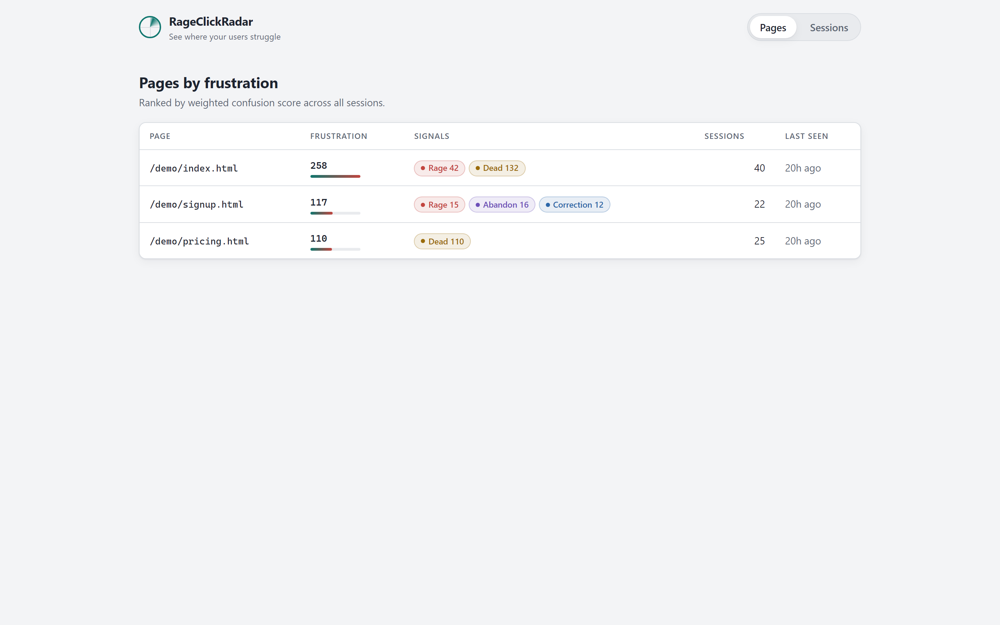
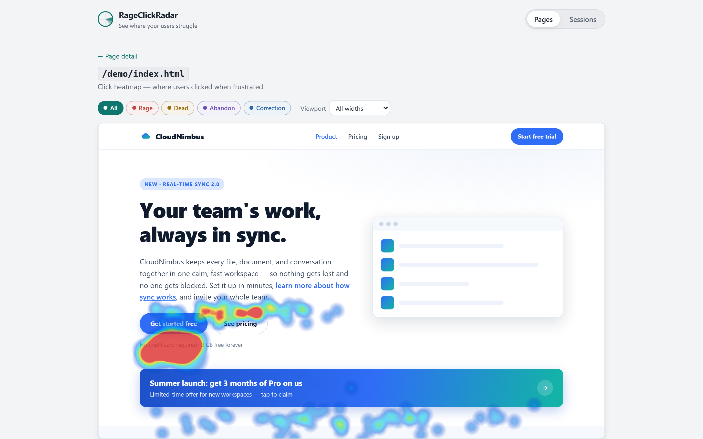
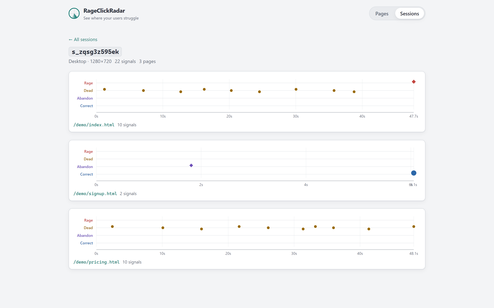

# RageClickRadar

[](https://github.com/IACBI/rageclickradar/actions/workflows/ci.yml)
[](LICENSE)
[](docs/self-hosting.md)
[](tracker/build.js)

**English** · [Türkçe](#türkçe) · [中文](#中文) · [Русский](#русский) · [العربية](#العربية) · [日本語](#日本語)

**Frustration analytics without the surveillance.** A privacy-first, self-hosted
alternative to Hotjar-style tools: it finds the buttons that do nothing, the
forms people give up on, and the spots where users angrily click over and over —
without cookies, without recording keystrokes, and without ever storing an IP
address or a user agent.

One dependency-free `<script>` snippet (under 5 KB), a single Node process with
zero runtime dependencies, and a plain SQLite file you own. That is the whole
product.

## Why

Most session-analytics tools work by collecting as much as they can: full URLs,
mouse recordings, keystrokes, IP-based identities, cross-site cookies. That is a
privacy liability and, in many jurisdictions, a consent-banner problem.

RageClickRadar takes the opposite approach. It computes *behavioral signals* in
the browser — a rage-click burst, a dead click, an abandoned form — and sends
only the anonymous conclusion (a signal type, a sanitized CSS selector, a
coordinate, a magnitude). No text, no values, no identity. The frustrating parts
of your UI still light up; the surveillance apparatus never gets built. See
[docs/privacy.md](docs/privacy.md) for the exact wire schema and the full
not-collected list.

## Quickstart

You need **Node 22.5 or newer** (Node 24 LTS recommended — see
[docs/self-hosting.md](docs/self-hosting.md) for the version matrix). Then:

```bash
git clone https://github.com/IACBI/rageclickradar.git
cd rageclickradar
npm install && npm run demo
```

`npm run demo` builds the tracker if needed, starts the server, seeds a batch of
synthetic frustration sessions into a local demo database if it is empty, and
prints the URLs to open. Point your browser at the dashboard URL it prints and
explore the pre-seeded data; the "CloudNimbus" demo site (a deliberately
confusing three-page fake SaaS, full of traps) is served alongside it so you can
generate your own signals by clicking around.

### Instrument your own site

Drop one line into your pages. If your site is served by the same origin as the
collector:

```html
<script src="/radar.js" defer></script>
```

If your site lives on a different origin than the collector, point the snippet at
your collector explicitly with `data-endpoint`:

```html
<script src="https://your-host/radar.js"
        data-endpoint="https://your-host/api/collect" defer></script>
```

That is the entire install. Add `data-radar-ignore` to any element (or an
ancestor) to exclude it from tracking. Add `data-radar-allow-rapid` to any
element (or an ancestor) to suppress rage-click detection there — for controls
where repeated clicking is expected. The tracker already auto-exempts rapid
clicking on `input[type=number]`, `[role=spinbutton]`, `[role=slider]`, and any
element whose class contains `stepper`, `carousel`, or `qty`. Within a minute of
real traffic the dashboard at `/` starts showing per-page confusion scores, click
heatmaps, selector-level hotspots, and individual anonymous session timelines.

## Signals

RageClickRadar detects four kinds of frustration. Every threshold is a plain
number in [`shared/config.js`](shared/config.js) and can be overridden per-site
at runtime (see [Configuration](#configuration)).

| Signal | What it means | Default trigger | Tune via (`window.RadarConfig` keys) |
| --- | --- | --- | --- |
| **Rage click** | User clicks the same spot repeatedly in frustration. | ≥ 3 clicks, each within 500 ms of the last, all within a 30 px radius; the burst is emitted 700 ms after the last click. | `RAGE_MIN_CLICKS`, `RAGE_MAX_GAP_MS`, `RAGE_RADIUS_PX`, `RAGE_SETTLE_MS` |
| **Dead click** | User clicks something that looks clickable but isn't. | A non-interactive target (no link/button/role, no `cursor: pointer`) with no DOM mutation, scroll, text selection, or URL change within 600 ms. | `DEAD_WAIT_MS`, `DEAD_MAX_ANCESTORS`, `DEAD_SCROLL_PX`, `DEAD_DRAG_PX` |
| **Form abandonment** | User engages a form, then leaves without submitting. | A field received ≥ 3 input events and the form was never submitted; fires on page-hide, or after 30 s of focus elsewhere. A standalone search field (a lone search input, ≤ 1 field) never fires it. | `FORM_MIN_INPUTS`, `FORM_BLUR_ABANDON_MS` |
| **Correction** | User fights a field, deleting and retyping heavily. | In one field engagement: ≥ 8 deletions **and** deletions ≥ 0.5 × insertions (counted from input-event types only — the text is never read). | `CORRECTION_MIN_DELETES`, `CORRECTION_RATIO` |

Each page's **confusion score** is the sum of its signal rows weighted by type:
rage 3, form abandonment 3, correction 2, dead 1 (`SCORE_WEIGHTS`, server-side).

## Screenshots







## Configuration

### Runtime tracker overrides

Set `window.RadarConfig` **before** the snippet loads to override any threshold.
Use the full key names below; each key is optional and falls back to its default.

```html
<script>
  window.RadarConfig = { RAGE_MIN_CLICKS: 4, DEAD_WAIT_MS: 800 };
</script>
<script src="/radar.js" defer></script>
```

| Key | Default | Meaning |
| --- | --- | --- |
| `RAGE_MIN_CLICKS` | `3` | Clicks needed to qualify as a rage burst. |
| `RAGE_MAX_GAP_MS` | `500` | Max ms between consecutive clicks in a burst. |
| `RAGE_RADIUS_PX` | `30` | Max px distance from the burst's first click. |
| `RAGE_SETTLE_MS` | `700` | Ms of silence that closes a burst (single emit). |
| `DEAD_WAIT_MS` | `600` | Reaction window after a click before it's declared dead. |
| `DEAD_MAX_ANCESTORS` | `10` | Ancestor levels walked when checking interactivity. |
| `DEAD_SCROLL_PX` | `5` | Scroll movement (px) that counts as a page reaction. |
| `DEAD_DRAG_PX` | `5` | Pointer travel between down/up that means a text-selection drag. |
| `FORM_MIN_INPUTS` | `3` | Input events on a field before the form counts as engaged. |
| `FORM_BLUR_ABANDON_MS` | `30000` | Ms of focus outside an engaged form before mid-session abandon. |
| `CORRECTION_MIN_DELETES` | `8` | Min deletions in one field engagement to consider a signal. |
| `CORRECTION_RATIO` | `0.5` | Deletions must be ≥ ratio × insertions to fire. |
| `MAX_EVENTS_PER_PAGEVIEW` | `200` | Hard cap per page view; the tracker goes silent afterward. |
| `BATCH_MAX_EVENTS` | `50` | Flush a batch when this many events are buffered. |
| `BATCH_INTERVAL_MS` | `5000` | Periodic flush interval. |
| `SELECTOR_MAX_LEN` | `120` | Hard cap on the emitted CSS selector length. |

### Server environment variables

| Variable | Default | Meaning |
| --- | --- | --- |
| `PORT` | `8639` | HTTP port for the collector and dashboard. |
| `DB_PATH` | `./data/radar.db` | SQLite database file (WAL mode; parent dir is created). |
| `HOST` | `127.0.0.1` | Interface to bind. Loopback only by default; set `0.0.0.0` to expose it (the read API has no authentication). |
| `TRUST_PROXY` | *(empty)* | Comma-separated IPs of reverse proxies whose `X-Forwarded-For` is trusted for rate limiting. |
| `RETENTION_DAYS` | *(off)* | Delete events and sessions older than this many days, at startup and hourly. Empty or `0` keeps everything. See [self-hosting.md](docs/self-hosting.md#data-retention). |
| `PATH_REDACTION` | `on` | `off` stores page paths verbatim. Otherwise identifier-like segments (numbers, UUIDs, tokens) are stored as `:id`. See [privacy.md](docs/privacy.md). |

Server-side thresholds (`DEFAULT_PORT`, `MAX_BODY_BYTES`, `RATE_LIMIT_PER_MIN`,
`SCORE_WEIGHTS`) also live in `shared/config.js` but are not browser-overridable.

## Architecture

```
  Browser                          Your server (one Node process)
 +-----------+   POST text/plain   +----------------------------+
 |  radar.js | ------------------> |  /api/collect  (validate,  |
 | (<5 KB)   |   {v,sid,page,...}  |   rate-limit, whitelist)   |
 +-----------+                     +-------------+--------------+
      ^  computes signals                        |
      |  in the browser;                         v
      |  sends conclusions              +------------------+
      |  only (no text/PII)             |  SQLite (WAL)    |
      |                                 |  radar.db        |
      |                                 +--------+---------+
      |   GET /api/pages|heatmap|...             |
 +----+------------------------------------------v---------+
 |  Dashboard (vanilla JS, served from /)                  |
 +--------------------------------------------------------+
```

The collector only ever writes whitelisted fields; there is no IP, user agent, or
header column anywhere in the schema.

### Repo layout

```
shared/config.js        Single source of truth for every threshold
tracker/src/            Browser tracker source (radar, detectors, selector, transport)
tracker/build.js        esbuild bundle -> tracker/dist/radar.min.js (<5 KB budget)
server/                 Zero-dependency Node server
  index.js              Entry: reads PORT / HOST / DB_PATH / TRUST_PROXY, opens DB, starts HTTP
  http.js               Routing, CORS, static serving, rate limiting
  collect.js            Payload validation + storage (the field whitelist)
  queries.js            Read/aggregation endpoints
  db.js                 node:sqlite open + migration (WAL)
dashboard/              Vanilla-JS dashboard (served at /)
demo/                   "CloudNimbus" demo site with intentional traps (/demo/)
tools/generate-sessions.js  Synthetic session seeder
test/unit/              Node built-in test-runner unit tests
test/e2e/               Playwright end-to-end tests
docs/                   This documentation
```

## FAQ

**Do I need cookie consent / is this GDPR-friendly?**
RageClickRadar is designed to avoid collecting personal data: no cookies, no IP
storage, no fingerprinting, per-tab anonymous ids only. That is intended to keep
you out of consent-banner territory, but interpretations vary by jurisdiction and
this is not legal advice. Read [docs/privacy.md](docs/privacy.md) before you
decide. Path identifiers (numeric IDs, UUIDs, tokens) are redacted before storage by default, but element `id` and `class` values are stored as written, so keep personal data out of them. See [privacy.md](docs/privacy.md).

**Does it work with single-page apps?**
Yes. The tracker listens on `popstate` and `hashchange`, so History-API and hash
URL changes count as page reactions (a route change won't be misread as a dead
click). Signals carry `location.pathname` only.

**Do my users need accounts? Do I?**
No accounts anywhere — not for visitors, not for you. There is no auth layer in
the MVP; put the dashboard behind your reverse proxy or a VPN if you want to
restrict it (see [docs/self-hosting.md](docs/self-hosting.md)).

**How big is the snippet?**
The minified bundle is 5104 bytes (hard budget: 5120), dependency-free.

**How do I delete data?**
It is your SQLite file. Set `RETENTION_DAYS` to delete old data automatically (off by default; 90 is a sensible start). To wipe everything, stop the server and delete `radar.db` (plus its `-wal` / `-shm` siblings). See [docs/self-hosting.md](docs/self-hosting.md#data-retention).

**Production hardening?**
See [docs/self-hosting.md](docs/self-hosting.md) for systemd, HTTPS reverse
proxies, backups, retention, and multi-site notes.

## Development

```bash
npm test                       # unit tests (Node built-in runner)
npm run build:tracker          # rebuild tracker/dist/radar.min.js (enforces <5 KB)
npm start                      # run the server (PORT, HOST, DB_PATH, TRUST_PROXY from env)
npm run seed -- --sessions 40 --seed 42 --url http://localhost:8639 --verify
npm run test:e2e               # Playwright end-to-end tests
```

> **Note:** The `test` script uses the glob form (`node --test test/unit/*.test.js`)
> because `node --test <directory>` does not expand a directory argument reliably
> on Windows.

The seeder POSTs synthetic sessions through the real `/api/collect` endpoint, so
the server must be running first. A fixed `--seed` makes generation fully
deterministic; `--verify` asserts the seeded corpus is demo-ready via the read
endpoints.

## Contributing

Contributions are welcome — bug fixes, docs, tests, and well-scoped features.
Start with [CONTRIBUTING.md](CONTRIBUTING.md) for dev setup, how to run the
tests, and the hard rules that keep the project honest (the 5 KB tracker budget,
zero server runtime dependencies, and the privacy invariants). Please also read
our [Code of Conduct](CODE_OF_CONDUCT.md).

Found a security issue? Please report it privately — see
[SECURITY.md](SECURITY.md).

## License

MIT — © 2026 𝓐.𝓒.𝓑. See [LICENSE](LICENSE).

---

## Türkçe

[English](#rageclickradar) · **Türkçe** · [中文](#中文) · [Русский](#русский) · [العربية](#العربية) · [日本語](#日本語)

**Gözetim olmadan hüsran analitiği.** Hotjar tarzı araçlara gizlilik öncelikli,
kendi sunucunuzda barındırılan bir alternatif: hiçbir işe yaramayan düğmeleri,
insanların pes ettiği formları ve kullanıcıların öfkeyle üst üste tıkladığı
noktaları bulur — çerez kullanmadan, tuş vuruşlarını kaydetmeden ve hiçbir zaman
bir IP adresi ya da kullanıcı aracısı (user agent) saklamadan.

Bağımlılık içermeyen tek bir `<script>` snippet'i (5 KB'ın altında), çalışma
zamanı bağımlılığı sıfır olan tek bir Node süreci ve tamamen size ait düz bir
SQLite dosyası. Ürünün tamamı bundan ibaret.

### Neden

Çoğu oturum analitiği aracı, toplayabildiği kadar çok şey toplayarak çalışır: tam
URL'ler, fare kayıtları, tuş vuruşları, IP tabanlı kimlikler, siteler arası
çerezler. Bu bir gizlilik yükümlülüğüdür ve birçok yargı bölgesinde bir onay
bandı (consent banner) sorunudur.

RageClickRadar tam tersi bir yaklaşım benimser. *Davranışsal sinyalleri*
tarayıcıda hesaplar — bir öfke tıklaması serisi, bir ölü tıklama, terk edilmiş
bir form — ve yalnızca anonim sonucu gönderir (bir sinyal türü, temizlenmiş bir
CSS seçici, bir koordinat, bir büyüklük). Metin yok, değer yok, kimlik yok.
Arayüzünüzün can sıkıcı bölümleri yine de öne çıkar; gözetim aygıtı ise hiçbir
zaman kurulmaz. Tam veri şeması (wire schema) ve toplanmayanların tam listesi
için [docs/privacy.md](docs/privacy.md) dosyasına bakın.

### Hızlı başlangıç

**Node 22.5 veya daha yenisi** gerekir (Node 24 LTS önerilir — sürüm matrisi için
[docs/self-hosting.md](docs/self-hosting.md) dosyasına bakın). Ardından:

```bash
git clone https://github.com/IACBI/rageclickradar.git
cd rageclickradar
npm install && npm run demo
```

`npm run demo`, gerekirse tracker'ı derler, sunucuyu başlatır, yerel demo
veritabanı boşsa içine bir grup sentetik hüsran oturumu ekler ve açılacak
URL'leri yazdırır. Tarayıcınızı yazdırdığı pano URL'sine yönlendirin ve önceden
yüklenmiş verileri inceleyin; "CloudNimbus" demo sitesi (kasıtlı olarak kafa
karıştırıcı, tuzaklarla dolu üç sayfalık sahte bir SaaS) bunun yanında sunulur,
böylece etrafta tıklayarak kendi sinyallerinizi üretebilirsiniz.

#### Kendi sitenizi izlemeye alın

Sayfalarınıza tek bir satır ekleyin. Siteniz toplayıcıyla aynı origin'den
sunuluyorsa:

```html
<script src="/radar.js" defer></script>
```

Siteniz toplayıcıdan farklı bir origin'de yaşıyorsa, snippet'i `data-endpoint`
ile toplayıcınıza açıkça yönlendirin:

```html
<script src="https://your-host/radar.js"
        data-endpoint="https://your-host/api/collect" defer></script>
```

Kurulumun tamamı bu kadar. İzlemeden hariç tutmak için herhangi bir öğeye (veya
bir üst öğesine) `data-radar-ignore` ekleyin. Tekrarlı tıklamanın beklendiği
kontrollerde öfke tıklaması algılamasını bastırmak için herhangi bir öğeye (veya
bir üst öğesine) `data-radar-allow-rapid` ekleyin. Tracker, `input[type=number]`,
`[role=spinbutton]`, `[role=slider]` ve sınıfı `stepper`, `carousel` ya da `qty`
içeren herhangi bir öğede hızlı tıklamayı zaten otomatik olarak muaf tutar.
Gerçek trafiğin bir dakikası içinde `/` adresindeki pano; sayfa bazında kafa
karışıklığı puanlarını, tıklama ısı haritalarını, seçici düzeyinde etkin
noktaları ve tek tek anonim oturum zaman çizelgelerini göstermeye başlar.

### Sinyaller

RageClickRadar dört tür hüsran algılar. Her eşik,
[`shared/config.js`](shared/config.js) içinde düz bir sayıdır ve çalışma zamanında
site bazında geçersiz kılınabilir (bkz. [Yapılandırma](#yapılandırma)).

| Sinyal | Anlamı | Varsayılan tetikleyici | Ayar anahtarları (`window.RadarConfig`) |
| --- | --- | --- | --- |
| **Öfke tıklaması (Rage click)** | Kullanıcı hüsranla aynı noktaya üst üste tıklar. | ≥ 3 tıklama, her biri bir öncekinden 500 ms içinde ve tümü 30 px yarıçapında; seri, son tıklamadan 700 ms sonra yayınlanır. | `RAGE_MIN_CLICKS`, `RAGE_MAX_GAP_MS`, `RAGE_RADIUS_PX`, `RAGE_SETTLE_MS` |
| **Ölü tıklama (Dead click)** | Kullanıcı tıklanabilir görünen ama tıklanamayan bir şeye tıklar. | Etkileşimli olmayan bir hedef (bağlantı/düğme/rol yok, `cursor: pointer` yok) ve 600 ms içinde DOM değişikliği, kaydırma, metin seçimi veya URL değişikliği olmaması. | `DEAD_WAIT_MS`, `DEAD_MAX_ANCESTORS`, `DEAD_SCROLL_PX`, `DEAD_DRAG_PX` |
| **Form terk etme (Form abandonment)** | Kullanıcı bir formla etkileşime girer, ardından göndermeden ayrılır. | Bir alan ≥ 3 input olayı aldı ve form hiç gönderilmedi; sayfa gizlenince veya başka bir yerde 30 sn odaklanma sonrası tetiklenir. Tek başına bir arama alanı (tek bir arama input'u, ≤ 1 alan) bunu asla tetiklemez. | `FORM_MIN_INPUTS`, `FORM_BLUR_ABANDON_MS` |
| **Düzeltme (Correction)** | Kullanıcı bir alanla boğuşur, yoğun şekilde silip yeniden yazar. | Tek bir alan etkileşiminde: ≥ 8 silme **ve** silmeler ≥ 0.5 × eklemeler (yalnızca input-olay türlerinden sayılır — metin asla okunmaz). | `CORRECTION_MIN_DELETES`, `CORRECTION_RATIO` |

Her sayfanın **kafa karışıklığı puanı (confusion score)**, sinyal satırlarının
türe göre ağırlıklandırılmış toplamıdır: rage 3, form terk etme 3, düzeltme 2,
ölü tıklama 1 (`SCORE_WEIGHTS`, sunucu tarafında).

### Ekran görüntüleri

Panoyu, ısı haritasını ve oturum zaman çizelgesini gösteren ekran görüntüleri
için İngilizce bölümdeki [Screenshots](#screenshots) kısmına bakın.

### Yapılandırma

#### Çalışma zamanı tracker geçersiz kılmaları

Herhangi bir eşiği geçersiz kılmak için `window.RadarConfig` değerini snippet
yüklenmeden **önce** ayarlayın. Aşağıdaki tam anahtar adlarını kullanın; her
anahtar isteğe bağlıdır ve varsayılan değerine geri döner.

```html
<script>
  window.RadarConfig = { RAGE_MIN_CLICKS: 4, DEAD_WAIT_MS: 800 };
</script>
<script src="/radar.js" defer></script>
```

| Anahtar | Varsayılan | Anlamı |
| --- | --- | --- |
| `RAGE_MIN_CLICKS` | `3` | Bir öfke serisi sayılması için gereken tıklama sayısı. |
| `RAGE_MAX_GAP_MS` | `500` | Bir serideki ardışık tıklamalar arasındaki maksimum ms. |
| `RAGE_RADIUS_PX` | `30` | Serinin ilk tıklamasından maksimum px uzaklık. |
| `RAGE_SETTLE_MS` | `700` | Bir seriyi kapatan sessizlik süresi (tek yayın), ms. |
| `DEAD_WAIT_MS` | `600` | Bir tıklama ölü ilan edilmeden önceki tepki penceresi. |
| `DEAD_MAX_ANCESTORS` | `10` | Etkileşim kontrolünde gezilen üst öğe (ancestor) seviyesi sayısı. |
| `DEAD_SCROLL_PX` | `5` | Sayfa tepkisi sayılan kaydırma hareketi (px). |
| `DEAD_DRAG_PX` | `5` | Metin seçimi sürüklemesi anlamına gelen, basma/bırakma arası imleç yolu. |
| `FORM_MIN_INPUTS` | `3` | Formun etkileşime girmiş sayılması için bir alandaki input olayı sayısı. |
| `FORM_BLUR_ABANDON_MS` | `30000` | Etkileşimli bir formun dışında, oturum ortası terk sayılmadan önceki odak süresi (ms). |
| `CORRECTION_MIN_DELETES` | `8` | Sinyal değerlendirmek için tek alan etkileşimindeki minimum silme. |
| `CORRECTION_RATIO` | `0.5` | Tetiklenmesi için silmeler ≥ oran × eklemeler olmalı. |
| `MAX_EVENTS_PER_PAGEVIEW` | `200` | Sayfa görüntüleme başına kesin üst sınır; sonrasında tracker susar. |
| `BATCH_MAX_EVENTS` | `50` | Bu kadar olay tamponlandığında bir batch gönderilir. |
| `BATCH_INTERVAL_MS` | `5000` | Periyodik gönderim aralığı. |
| `SELECTOR_MAX_LEN` | `120` | Yayınlanan CSS seçici uzunluğunda kesin üst sınır. |

#### Sunucu ortam değişkenleri

| Değişken | Varsayılan | Anlamı |
| --- | --- | --- |
| `PORT` | `8639` | Toplayıcı ve pano için HTTP portu. |
| `DB_PATH` | `./data/radar.db` | SQLite veritabanı dosyası (WAL modu; üst dizin oluşturulur). |
| `HOST` | `127.0.0.1` | Bağlanılacak arayüz. Varsayılan yalnızca loopback; `0.0.0.0` ile dışarı açılır (okuma API'sinin kimlik doğrulaması yok). |
| `TRUST_PROXY` | *(boş)* | Hız sınırlaması için `X-Forwarded-For` değerine güvenilen ters proxy'lerin virgülle ayrılmış IP'leri. |
| `RETENTION_DAYS` | *(kapalı)* | Bu gün sayısından eski olayları ve oturumları başlangıçta ve saatte bir siler. Boş veya `0` her şeyi saklar. Bkz. [self-hosting.md](docs/self-hosting.md#veri-saklama). |
| `PATH_REDACTION` | `on` | `off` yolları olduğu gibi saklar; aksi halde tanımlayıcı benzeri parçalar (sayılar, UUID'ler, belirteçler) `:id` olarak saklanır. Bkz. [privacy.md](docs/privacy.md). |

Sunucu tarafı eşikler (`DEFAULT_PORT`, `MAX_BODY_BYTES`, `RATE_LIMIT_PER_MIN`,
`SCORE_WEIGHTS`) da `shared/config.js` içinde yer alır ancak tarayıcıdan geçersiz
kılınamaz.

### Mimari

```
  Browser                          Your server (one Node process)
 +-----------+   POST text/plain   +----------------------------+
 |  radar.js | ------------------> |  /api/collect  (validate,  |
 | (<5 KB)   |   {v,sid,page,...}  |   rate-limit, whitelist)   |
 +-----------+                     +-------------+--------------+
      ^  computes signals                        |
      |  in the browser;                         v
      |  sends conclusions              +------------------+
      |  only (no text/PII)             |  SQLite (WAL)    |
      |                                 |  radar.db        |
      |                                 +--------+---------+
      |   GET /api/pages|heatmap|...             |
 +----+------------------------------------------v---------+
 |  Dashboard (vanilla JS, served from /)                  |
 +--------------------------------------------------------+
```

Toplayıcı yalnızca beyaz listeye alınmış alanları yazar; şemanın hiçbir yerinde
IP, kullanıcı aracısı veya başlık (header) sütunu yoktur.

#### Depo düzeni

```
shared/config.js        Single source of truth for every threshold
tracker/src/            Browser tracker source (radar, detectors, selector, transport)
tracker/build.js        esbuild bundle -> tracker/dist/radar.min.js (<5 KB budget)
server/                 Zero-dependency Node server
  index.js              Entry: reads PORT / HOST / DB_PATH / TRUST_PROXY, opens DB, starts HTTP
  http.js               Routing, CORS, static serving, rate limiting
  collect.js            Payload validation + storage (the field whitelist)
  queries.js            Read/aggregation endpoints
  db.js                 node:sqlite open + migration (WAL)
dashboard/              Vanilla-JS dashboard (served at /)
demo/                   "CloudNimbus" demo site with intentional traps (/demo/)
tools/generate-sessions.js  Synthetic session seeder
test/unit/              Node built-in test-runner unit tests
test/e2e/               Playwright end-to-end tests
docs/                   This documentation
```

### SSS

**Çerez onayına ihtiyacım var mı / bu GDPR uyumlu mu?**
RageClickRadar, kişisel veri toplamaktan kaçınacak şekilde tasarlanmıştır: çerez
yok, IP saklama yok, parmak izi çıkarma yok, yalnızca sekme başına anonim
kimlikler. Bu, sizi onay bandı bölgesinden uzak tutmayı amaçlar, ancak yorumlar
yargı bölgesine göre değişir ve bu hukuki tavsiye değildir. Karar vermeden önce
[docs/privacy.md](docs/privacy.md) dosyasını okuyun. Yol içindeki tanımlayıcılar (sayısal kimlikler, UUID'ler, belirteçler) varsayılan olarak depolamadan önce gizlenir; öğe `id` ve `class` değerleri ise yazıldığı gibi saklanır, bu yüzden oraya kişisel veri koymayın. Bkz. [privacy.md](docs/privacy.md).

**Tek sayfalık uygulamalarla (SPA) çalışır mı?**
Evet. Tracker, `popstate` ve `hashchange` olaylarını dinler; böylece History API
ve hash URL değişiklikleri birer sayfa tepkisi olarak sayılır (bir rota
değişikliği ölü tıklama olarak yanlış okunmaz). Sinyaller yalnızca
`location.pathname` taşır.

**Kullanıcılarımın hesaba ihtiyacı var mı? Ya benim?**
Hiçbir yerde hesap yok — ne ziyaretçiler için ne de sizin için. MVP'de kimlik
doğrulama katmanı yoktur; erişimi kısıtlamak isterseniz panoyu ters proxy'nizin
veya bir VPN'in arkasına koyun (bkz. [docs/self-hosting.md](docs/self-hosting.md)).

**Snippet ne kadar büyük?**
Küçültülmüş paket 5104 bayttır (kesin bütçe: 5120), bağımlılık içermez.

**Verileri nasıl silerim?**
Bu sizin SQLite dosyanızdır. Eski verileri otomatik silmek için `RETENTION_DAYS` ayarlayın (varsayılan kapalı; 90 makul bir başlangıçtır). Her şeyi silmek için sunucuyu durdurun ve `radar.db` dosyasını (yanındaki `-wal` / `-shm` dosyalarıyla birlikte) silin. Bkz. [docs/self-hosting.md](docs/self-hosting.md#veri-saklama).

**Üretim için sağlamlaştırma?**
systemd, HTTPS ters proxy'ler, yedekler, saklama ve çoklu site notları için
[docs/self-hosting.md](docs/self-hosting.md) dosyasına bakın.

### Geliştirme

```bash
npm test                       # unit tests (Node built-in runner)
npm run build:tracker          # rebuild tracker/dist/radar.min.js (enforces <5 KB)
npm start                      # run the server (PORT, HOST, DB_PATH, TRUST_PROXY from env)
npm run seed -- --sessions 40 --seed 42 --url http://localhost:8639 --verify
npm run test:e2e               # Playwright end-to-end tests
```

> **Not:** `test` betiği glob biçimini (`node --test test/unit/*.test.js`) kullanır;
> çünkü `node --test <directory>` bir dizin argümanını Windows'ta güvenilir
> biçimde genişletmez.

Tohumlayıcı (seeder), sentetik oturumları gerçek `/api/collect` uç noktası
üzerinden POST eder; bu nedenle sunucunun önce çalışıyor olması gerekir. Sabit bir
`--seed`, üretimi tamamen deterministik yapar; `--verify`, tohumlanan korpusun
okuma uç noktaları üzerinden demoya hazır olduğunu doğrular.

### Katkıda bulunma

Katkılar memnuniyetle karşılanır — hata düzeltmeleri, dokümanlar, testler ve iyi
kapsamlı özellikler. Geliştirme kurulumu, testlerin nasıl çalıştırılacağı ve
projeyi dürüst tutan katı kurallar (5 KB tracker bütçesi, sıfır sunucu çalışma
zamanı bağımlılığı ve gizlilik değişmezleri) için
[CONTRIBUTING.md](CONTRIBUTING.md) ile başlayın. Lütfen
[Davranış Kuralları](CODE_OF_CONDUCT.md) belgemizi de okuyun.

Bir güvenlik açığı mı buldunuz? Lütfen bunu özel olarak bildirin — bkz.
[SECURITY.md](SECURITY.md).

### Lisans

MIT — © 2026 𝓐.𝓒.𝓑. Bkz. [LICENSE](LICENSE).

---

## 中文

[English](#rageclickradar) · [Türkçe](#türkçe) · **中文** · [Русский](#русский) · [العربية](#العربية) · [日本語](#日本語)

**无监控的挫败感分析。** 一个隐私优先、可自托管的 Hotjar 类工具替代方案：它能找出毫无反应的按钮、让人半途放弃的表单，以及用户愤怒地反复点击的位置——不使用 Cookie，不记录按键，也从不存储 IP 地址或用户代理（user agent）。

仅需一段无依赖的 `<script>` 代码片段（小于 5 KB）、一个零运行时依赖的 Node 进程，以及一个完全归你所有的普通 SQLite 文件。这就是产品的全部。

### 为什么

大多数会话分析工具的工作方式是尽可能多地收集数据：完整 URL、鼠标录制、按键、基于 IP 的身份标识、跨站 Cookie。这既是隐私隐患，在许多司法辖区中还会带来同意横幅（consent banner）的问题。

RageClickRadar 采用相反的思路。它在浏览器中计算*行为信号*——一次愤怒点击连击、一次死点击、一个被放弃的表单——并且只发送匿名的结论（信号类型、经过净化的 CSS 选择器、一个坐标、一个量级）。没有文本、没有取值、没有身份。你界面中令人挫败的部分依旧会被点亮；而监控装置却永远不会被搭建起来。有关确切的传输数据结构（wire schema）以及完整的“不收集”清单，请参阅 [docs/privacy.md](docs/privacy.md)。

### 快速开始

你需要 **Node 22.5 或更高版本**（推荐 Node 24 LTS——版本对照表见 [docs/self-hosting.md](docs/self-hosting.md)）。然后：

```bash
git clone https://github.com/IACBI/rageclickradar.git
cd rageclickradar
npm install && npm run demo
```

`npm run demo` 会在需要时构建 tracker、启动服务器、在本地演示数据库为空时向其填充一批合成的挫败感会话，并打印出可打开的 URL。将浏览器指向它打印的仪表盘 URL，浏览预先填充的数据；“CloudNimbus” 演示站点（一个故意让人困惑、遍布陷阱的三页假 SaaS）会与之一同提供，方便你通过四处点击生成自己的信号。

#### 为你自己的站点埋点

在你的页面中加入一行。如果你的站点与采集器同源提供服务：

```html
<script src="/radar.js" defer></script>
```

如果你的站点与采集器不在同一源，请用 `data-endpoint` 将代码片段显式指向你的采集器：

```html
<script src="https://your-host/radar.js"
        data-endpoint="https://your-host/api/collect" defer></script>
```

安装到此为止。为任意元素（或其祖先元素）添加 `data-radar-ignore` 即可将其排除在跟踪之外。为任意元素（或其祖先元素）添加 `data-radar-allow-rapid` 可在该处抑制愤怒点击检测——适用于预期会重复点击的控件。tracker 已自动豁免对 `input[type=number]`、`[role=spinbutton]`、`[role=slider]` 以及任何类名包含 `stepper`、`carousel` 或 `qty` 的元素的快速点击。在真实流量出现的一分钟内，位于 `/` 的仪表盘便会开始显示各页面的困惑度评分、点击热力图、选择器级别的热点，以及一个个匿名会话的时间线。

### 信号

RageClickRadar 检测四类挫败感。每个阈值都是 [`shared/config.js`](shared/config.js) 中的一个普通数字，并且可以在运行时按站点覆盖（见[配置](#配置)）。

| 信号 | 含义 | 默认触发条件 | 调节方式（`window.RadarConfig` 键） |
| --- | --- | --- | --- |
| **愤怒点击（Rage click）** | 用户因挫败而反复点击同一位置。 | ≥ 3 次点击，每次都在上一次的 500 ms 内，且全部落在 30 px 半径内；连击在最后一次点击后 700 ms 发出。 | `RAGE_MIN_CLICKS`、`RAGE_MAX_GAP_MS`、`RAGE_RADIUS_PX`、`RAGE_SETTLE_MS` |
| **死点击（Dead click）** | 用户点击了看起来可点击但实际不可点击的东西。 | 一个非交互目标（无链接/按钮/角色，无 `cursor: pointer`），且在 600 ms 内没有 DOM 变更、滚动、文本选择或 URL 变化。 | `DEAD_WAIT_MS`、`DEAD_MAX_ANCESTORS`、`DEAD_SCROLL_PX`、`DEAD_DRAG_PX` |
| **表单放弃（Form abandonment）** | 用户与表单交互后，未提交便离开。 | 某字段收到 ≥ 3 次 input 事件且表单从未提交；在页面隐藏时，或在别处聚焦 30 秒后触发。独立的搜索字段（单个搜索输入框，≤ 1 个字段）绝不会触发它。 | `FORM_MIN_INPUTS`、`FORM_BLUR_ABANDON_MS` |
| **纠正（Correction）** | 用户与某字段较劲，大量删除并重新输入。 | 在一次字段交互中：≥ 8 次删除**且**删除次数 ≥ 0.5 × 插入次数（仅根据 input 事件类型计数——文本从不被读取）。 | `CORRECTION_MIN_DELETES`、`CORRECTION_RATIO` |

每个页面的**困惑度评分（confusion score）**是其信号行按类型加权后的总和：rage 3、form abandonment 3、correction 2、dead 1（`SCORE_WEIGHTS`，服务器端）。

### 截图

如需查看展示仪表盘、热力图和会话时间线的截图，请参阅英文部分的 [Screenshots](#screenshots)。

### 配置

#### 运行时 tracker 覆盖

在代码片段加载**之前**设置 `window.RadarConfig` 即可覆盖任意阈值。请使用下面的完整键名；每个键都是可选的，未设置时回退到其默认值。

```html
<script>
  window.RadarConfig = { RAGE_MIN_CLICKS: 4, DEAD_WAIT_MS: 800 };
</script>
<script src="/radar.js" defer></script>
```

| 键 | 默认值 | 含义 |
| --- | --- | --- |
| `RAGE_MIN_CLICKS` | `3` | 构成一次愤怒连击所需的点击次数。 |
| `RAGE_MAX_GAP_MS` | `500` | 连击中相邻两次点击之间的最大毫秒数。 |
| `RAGE_RADIUS_PX` | `30` | 距连击首次点击的最大像素距离。 |
| `RAGE_SETTLE_MS` | `700` | 关闭一次连击所需的静默毫秒数（单次发出）。 |
| `DEAD_WAIT_MS` | `600` | 判定点击为“死”之前的反应窗口。 |
| `DEAD_MAX_ANCESTORS` | `10` | 检查交互性时向上遍历的祖先层级数。 |
| `DEAD_SCROLL_PX` | `5` | 计为页面反应的滚动位移（像素）。 |
| `DEAD_DRAG_PX` | `5` | 按下与抬起之间、意味着文本选择拖动的指针移动距离。 |
| `FORM_MIN_INPUTS` | `3` | 字段被视为已交互前所需的 input 事件数。 |
| `FORM_BLUR_ABANDON_MS` | `30000` | 在已交互表单之外聚焦多少毫秒后计为会话中途放弃。 |
| `CORRECTION_MIN_DELETES` | `8` | 一次字段交互中考虑触发信号所需的最少删除次数。 |
| `CORRECTION_RATIO` | `0.5` | 删除次数须 ≥ 比例 × 插入次数才会触发。 |
| `MAX_EVENTS_PER_PAGEVIEW` | `200` | 每次页面浏览的硬性上限；超过后 tracker 保持静默。 |
| `BATCH_MAX_EVENTS` | `50` | 缓冲达到这么多事件时刷新一个批次。 |
| `BATCH_INTERVAL_MS` | `5000` | 周期性刷新间隔。 |
| `SELECTOR_MAX_LEN` | `120` | 发出的 CSS 选择器长度的硬性上限。 |

#### 服务器环境变量

| 变量 | 默认值 | 含义 |
| --- | --- | --- |
| `PORT` | `8639` | 采集器与仪表盘的 HTTP 端口。 |
| `DB_PATH` | `./data/radar.db` | SQLite 数据库文件（WAL 模式；会创建父目录）。 |
| `HOST` | `127.0.0.1` | 绑定的网络接口。默认仅回环地址；设为 `0.0.0.0` 即对外暴露（读取 API 无身份验证）。 |
| `TRUST_PROXY` | *（空）* | 速率限制时信任其 `X-Forwarded-For` 的反向代理的逗号分隔 IP。 |
| `RETENTION_DAYS` | *（关闭）* | 启动时及每小时删除早于该天数的事件和会话。留空或为 `0` 则全部保留。参见 [self-hosting.md](docs/self-hosting.md#数据保留)。 |
| `PATH_REDACTION` | `on` | `off` 原样存储页面路径；否则类似标识符的路径段（数字、UUID、令牌）存储为 `:id`。参见 [privacy.md](docs/privacy.md)。 |

服务器端阈值（`DEFAULT_PORT`、`MAX_BODY_BYTES`、`RATE_LIMIT_PER_MIN`、`SCORE_WEIGHTS`）同样位于 `shared/config.js` 中，但不可由浏览器覆盖。

### 架构

```
  Browser                          Your server (one Node process)
 +-----------+   POST text/plain   +----------------------------+
 |  radar.js | ------------------> |  /api/collect  (validate,  |
 | (<5 KB)   |   {v,sid,page,...}  |   rate-limit, whitelist)   |
 +-----------+                     +-------------+--------------+
      ^  computes signals                        |
      |  in the browser;                         v
      |  sends conclusions              +------------------+
      |  only (no text/PII)             |  SQLite (WAL)    |
      |                                 |  radar.db        |
      |                                 +--------+---------+
      |   GET /api/pages|heatmap|...             |
 +----+------------------------------------------v---------+
 |  Dashboard (vanilla JS, served from /)                  |
 +--------------------------------------------------------+
```

采集器只会写入白名单字段；数据库结构中任何地方都不存在 IP、用户代理或请求头列。

#### 仓库结构

```
shared/config.js        Single source of truth for every threshold
tracker/src/            Browser tracker source (radar, detectors, selector, transport)
tracker/build.js        esbuild bundle -> tracker/dist/radar.min.js (<5 KB budget)
server/                 Zero-dependency Node server
  index.js              Entry: reads PORT / HOST / DB_PATH / TRUST_PROXY, opens DB, starts HTTP
  http.js               Routing, CORS, static serving, rate limiting
  collect.js            Payload validation + storage (the field whitelist)
  queries.js            Read/aggregation endpoints
  db.js                 node:sqlite open + migration (WAL)
dashboard/              Vanilla-JS dashboard (served at /)
demo/                   "CloudNimbus" demo site with intentional traps (/demo/)
tools/generate-sessions.js  Synthetic session seeder
test/unit/              Node built-in test-runner unit tests
test/e2e/               Playwright end-to-end tests
docs/                   This documentation
```

### 常见问题

**我需要 Cookie 同意吗 / 它对 GDPR 友好吗？**
RageClickRadar 的设计目标就是避免收集个人数据：无 Cookie、不存储 IP、无指纹识别，仅使用每个标签页的匿名 id。这意在让你远离同意横幅的范畴，但各司法辖区的解读不尽相同，且本文并非法律建议。在做决定之前请阅读 [docs/privacy.md](docs/privacy.md)。默认情况下，路径中的标识符（数字 ID、UUID、令牌）在存储前会被脱敏；但元素的 `id` 和 `class` 按原样存储，因此请勿在其中放入个人数据。参见 [privacy.md](docs/privacy.md)。

**它适用于单页应用（SPA）吗？**
适用。tracker 会监听 `popstate` 和 `hashchange`，因此 History API 和 hash URL 变化都会计为页面反应（路由切换不会被误判为死点击）。信号仅携带 `location.pathname`。

**我的用户需要账号吗？我自己呢？**
任何地方都不需要账号——访客不需要，你也不需要。MVP 中没有鉴权层；如果你想限制访问，请把仪表盘放在你的反向代理或 VPN 之后（见 [docs/self-hosting.md](docs/self-hosting.md)）。

**这段代码片段有多大？**
压缩后的包为 5104 字节（硬性预算：5120），且无依赖。

**我该如何删除数据？**
那个 SQLite 文件是你的。设置 `RETENTION_DAYS` 可自动删除旧数据（默认关闭；90 是合理的起点）。若要清空全部数据，请停止服务器并删除 `radar.db`（以及同名的 `-wal` / `-shm` 文件）。参见 [docs/self-hosting.md](docs/self-hosting.md#数据保留)。

**生产环境加固？**
有关 systemd、HTTPS 反向代理、备份、数据保留以及多站点说明，请参阅 [docs/self-hosting.md](docs/self-hosting.md)。

### 开发

```bash
npm test                       # unit tests (Node built-in runner)
npm run build:tracker          # rebuild tracker/dist/radar.min.js (enforces <5 KB)
npm start                      # run the server (PORT, HOST, DB_PATH, TRUST_PROXY from env)
npm run seed -- --sessions 40 --seed 42 --url http://localhost:8639 --verify
npm run test:e2e               # Playwright end-to-end tests
```

> **注意：** `test` 脚本使用 glob 形式（`node --test test/unit/*.test.js`），因为 `node --test <directory>` 在 Windows 上无法可靠地展开目录参数。

seeder 会通过真实的 `/api/collect` 端点 POST 合成会话，因此必须先运行服务器。固定的 `--seed` 使生成完全确定；`--verify` 会通过读取端点断言所填充的语料已可用于演示。

### 贡献

欢迎贡献——缺陷修复、文档、测试以及范围明确的功能。请先阅读 [CONTRIBUTING.md](CONTRIBUTING.md)，了解开发环境搭建、如何运行测试，以及那些让项目保持诚实的硬性规则（5 KB 的 tracker 预算、零服务器运行时依赖，以及各项隐私不变量）。也请阅读我们的[行为准则](CODE_OF_CONDUCT.md)。

发现了安全问题？请私下报告——见 [SECURITY.md](SECURITY.md)。

### 许可证

MIT — © 2026 𝓐.𝓒.𝓑。参见 [LICENSE](LICENSE)。

---

## Русский

[English](#rageclickradar) · [Türkçe](#türkçe) · [中文](#中文) · **Русский** · [العربية](#العربية) · [日本語](#日本語)

**Аналитика фрустрации без слежки.** Приватная, self-hosted альтернатива
инструментам вроде Hotjar: она находит кнопки, которые ничего не делают, формы,
которые люди бросают, и места, где пользователи в раздражении кликают снова и
снова, — без cookie, без записи нажатий клавиш и без какого-либо хранения
IP-адреса или user agent.

Один не имеющий зависимостей фрагмент `<script>` (меньше 5 КБ), один процесс Node
с нулевыми рантайм-зависимостями и обычный файл SQLite, который принадлежит вам.
Это и есть весь продукт.

### Зачем

Большинство инструментов сессионной аналитики работают, собирая как можно больше:
полные URL, записи движений мыши, нажатия клавиш, идентификаторы на основе IP,
межсайтовые cookie. Это создаёт угрозу приватности, а во многих юрисдикциях — ещё
и проблему с баннером согласия.

RageClickRadar использует противоположный подход. Он вычисляет *поведенческие
сигналы* в браузере — всплеск rage-кликов, мёртвый клик, брошенную форму — и
отправляет только анонимный вывод (тип сигнала, очищенный CSS-селектор,
координату, величину). Ни текста, ни значений, ни личности. Раздражающие части
вашего интерфейса всё равно подсвечиваются, а аппарат слежки так и не
выстраивается. Точную схему передаваемых данных (wire schema) и полный список
того, что не собирается, см. в [docs/privacy.md](docs/privacy.md).

### Быстрый старт

Вам нужен **Node 22.5 или новее** (рекомендуется Node 24 LTS — матрицу версий
см. в [docs/self-hosting.md](docs/self-hosting.md)). Затем:

```bash
git clone https://github.com/IACBI/rageclickradar.git
cd rageclickradar
npm install && npm run demo
```

`npm run demo` при необходимости собирает tracker, запускает сервер, наполняет
локальную демо-базу пачкой синтетических сессий фрустрации, если она пуста, и
печатает URL для открытия. Направьте браузер на выведенный им URL панели и
изучите предзаполненные данные; демо-сайт «CloudNimbus» (намеренно запутанный
трёхстраничный поддельный SaaS, полный ловушек) обслуживается рядом, чтобы вы
могли сгенерировать собственные сигналы, кликая по нему.

#### Подключение на своём сайте

Добавьте одну строку на свои страницы. Если ваш сайт обслуживается с того же
источника (origin), что и коллектор:

```html
<script src="/radar.js" defer></script>
```

Если ваш сайт живёт на источнике, отличном от коллектора, явно укажите коллектор
во фрагменте через `data-endpoint`:

```html
<script src="https://your-host/radar.js"
        data-endpoint="https://your-host/api/collect" defer></script>
```

Это вся установка. Добавьте `data-radar-ignore` к любому элементу (или его
предку), чтобы исключить его из отслеживания. Добавьте `data-radar-allow-rapid` к
любому элементу (или его предку), чтобы подавить обнаружение rage-кликов в этом
месте — для элементов управления, где повторные клики ожидаемы. Tracker уже
автоматически освобождает от учёта быстрые клики по `input[type=number]`,
`[role=spinbutton]`, `[role=slider]` и любому элементу, класс которого содержит
`stepper`, `carousel` или `qty`. В течение минуты реального трафика панель по
адресу `/` начинает показывать оценки замешательства по страницам, тепловые карты
кликов, точки на уровне селекторов и отдельные анонимные таймлайны сессий.

### Сигналы

RageClickRadar обнаруживает четыре вида фрустрации. Каждый порог — это обычное
число в [`shared/config.js`](shared/config.js), и его можно переопределять для
каждого сайта во время выполнения (см. [Конфигурация](#конфигурация)).

| Сигнал | Что это значит | Условие по умолчанию | Настройка (ключи `window.RadarConfig`) |
| --- | --- | --- | --- |
| **Rage-клик (Rage click)** | Пользователь в раздражении многократно кликает в одно место. | ≥ 3 кликов, каждый в пределах 500 мс от предыдущего, все в радиусе 30 px; всплеск отправляется через 700 мс после последнего клика. | `RAGE_MIN_CLICKS`, `RAGE_MAX_GAP_MS`, `RAGE_RADIUS_PX`, `RAGE_SETTLE_MS` |
| **Мёртвый клик (Dead click)** | Пользователь кликает по чему-то, что выглядит кликабельным, но таковым не является. | Неинтерактивная цель (нет ссылки/кнопки/роли, нет `cursor: pointer`) без изменений DOM, прокрутки, выделения текста или смены URL в течение 600 мс. | `DEAD_WAIT_MS`, `DEAD_MAX_ANCESTORS`, `DEAD_SCROLL_PX`, `DEAD_DRAG_PX` |
| **Отказ от формы (Form abandonment)** | Пользователь взаимодействует с формой, затем уходит, не отправив её. | Поле получило ≥ 3 события input, а форма так и не была отправлена; срабатывает при скрытии страницы или после 30 с фокуса в другом месте. Отдельное поле поиска (одиночный search-input, ≤ 1 поля) никогда его не вызывает. | `FORM_MIN_INPUTS`, `FORM_BLUR_ABANDON_MS` |
| **Исправление (Correction)** | Пользователь борется с полем, активно удаляя и перепечатывая. | В рамках одного взаимодействия с полем: ≥ 8 удалений **и** удаления ≥ 0.5 × вставок (считается только по типам событий input — текст никогда не читается). | `CORRECTION_MIN_DELETES`, `CORRECTION_RATIO` |

**Оценка замешательства (confusion score)** каждой страницы — это сумма её
строк-сигналов, взвешенных по типу: rage 3, form abandonment 3, correction 2,
dead 1 (`SCORE_WEIGHTS`, на стороне сервера).

### Скриншоты

Скриншоты, показывающие панель, тепловую карту и таймлайн сессии, см. в разделе
[Screenshots](#screenshots) англоязычной части.

### Конфигурация

#### Переопределения tracker во время выполнения

Задайте `window.RadarConfig` **до** загрузки фрагмента, чтобы переопределить
любой порог. Используйте полные имена ключей ниже; каждый ключ необязателен и при
отсутствии откатывается к своему значению по умолчанию.

```html
<script>
  window.RadarConfig = { RAGE_MIN_CLICKS: 4, DEAD_WAIT_MS: 800 };
</script>
<script src="/radar.js" defer></script>
```

| Ключ | По умолчанию | Значение |
| --- | --- | --- |
| `RAGE_MIN_CLICKS` | `3` | Число кликов, необходимое, чтобы считаться всплеском rage. |
| `RAGE_MAX_GAP_MS` | `500` | Макс. мс между последовательными кликами во всплеске. |
| `RAGE_RADIUS_PX` | `30` | Макс. расстояние в px от первого клика всплеска. |
| `RAGE_SETTLE_MS` | `700` | Мс тишины, закрывающие всплеск (единичная отправка). |
| `DEAD_WAIT_MS` | `600` | Окно реакции после клика, прежде чем он объявляется мёртвым. |
| `DEAD_MAX_ANCESTORS` | `10` | Число уровней предков, проходимых при проверке интерактивности. |
| `DEAD_SCROLL_PX` | `5` | Смещение прокрутки (px), считающееся реакцией страницы. |
| `DEAD_DRAG_PX` | `5` | Перемещение указателя между нажатием и отпусканием, означающее перетаскивание для выделения текста. |
| `FORM_MIN_INPUTS` | `3` | События input на поле, прежде чем форма считается задействованной. |
| `FORM_BLUR_ABANDON_MS` | `30000` | Мс фокуса вне задействованной формы до отказа в середине сессии. |
| `CORRECTION_MIN_DELETES` | `8` | Мин. число удалений в одном взаимодействии с полем, чтобы рассматривать сигнал. |
| `CORRECTION_RATIO` | `0.5` | Удаления должны быть ≥ коэффициент × вставки, чтобы сработать. |
| `MAX_EVENTS_PER_PAGEVIEW` | `200` | Жёсткий предел на просмотр страницы; после него tracker умолкает. |
| `BATCH_MAX_EVENTS` | `50` | Отправить пакет, когда буферизовано столько событий. |
| `BATCH_INTERVAL_MS` | `5000` | Интервал периодической отправки. |
| `SELECTOR_MAX_LEN` | `120` | Жёсткий предел длины отправляемого CSS-селектора. |

#### Переменные окружения сервера

| Переменная | По умолчанию | Значение |
| --- | --- | --- |
| `PORT` | `8639` | HTTP-порт для коллектора и панели. |
| `DB_PATH` | `./data/radar.db` | Файл базы SQLite (режим WAL; родительский каталог создаётся). |
| `HOST` | `127.0.0.1` | Интерфейс для привязки. По умолчанию только loopback; `0.0.0.0` открывает доступ (у API чтения нет аутентификации). |
| `TRUST_PROXY` | *(пусто)* | Через запятую IP обратных прокси, чьему `X-Forwarded-For` доверяется при ограничении частоты. |
| `RETENTION_DAYS` | *(выкл.)* | Удаляет события и сессии старше указанного числа дней при запуске и затем ежечасно. Пустое значение или `0` означает хранить всё. См. [self-hosting.md](docs/self-hosting.md#хранение-данных). |
| `PATH_REDACTION` | `on` | `off` сохраняет пути страниц как есть; иначе сегменты, похожие на идентификаторы (числа, UUID, токены), сохраняются как `:id`. См. [privacy.md](docs/privacy.md). |

Серверные пороги (`DEFAULT_PORT`, `MAX_BODY_BYTES`, `RATE_LIMIT_PER_MIN`,
`SCORE_WEIGHTS`) также находятся в `shared/config.js`, но не переопределяются из
браузера.

### Архитектура

```
  Browser                          Your server (one Node process)
 +-----------+   POST text/plain   +----------------------------+
 |  radar.js | ------------------> |  /api/collect  (validate,  |
 | (<5 KB)   |   {v,sid,page,...}  |   rate-limit, whitelist)   |
 +-----------+                     +-------------+--------------+
      ^  computes signals                        |
      |  in the browser;                         v
      |  sends conclusions              +------------------+
      |  only (no text/PII)             |  SQLite (WAL)    |
      |                                 |  radar.db        |
      |                                 +--------+---------+
      |   GET /api/pages|heatmap|...             |
 +----+------------------------------------------v---------+
 |  Dashboard (vanilla JS, served from /)                  |
 +--------------------------------------------------------+
```

Коллектор всегда записывает только поля из белого списка; в схеме нигде нет
столбца с IP, user agent или заголовком.

#### Структура репозитория

```
shared/config.js        Single source of truth for every threshold
tracker/src/            Browser tracker source (radar, detectors, selector, transport)
tracker/build.js        esbuild bundle -> tracker/dist/radar.min.js (<5 KB budget)
server/                 Zero-dependency Node server
  index.js              Entry: reads PORT / HOST / DB_PATH / TRUST_PROXY, opens DB, starts HTTP
  http.js               Routing, CORS, static serving, rate limiting
  collect.js            Payload validation + storage (the field whitelist)
  queries.js            Read/aggregation endpoints
  db.js                 node:sqlite open + migration (WAL)
dashboard/              Vanilla-JS dashboard (served at /)
demo/                   "CloudNimbus" demo site with intentional traps (/demo/)
tools/generate-sessions.js  Synthetic session seeder
test/unit/              Node built-in test-runner unit tests
test/e2e/               Playwright end-to-end tests
docs/                   This documentation
```

### Частые вопросы

**Нужно ли мне согласие на cookie / дружелюбен ли он к GDPR?**
RageClickRadar спроектирован так, чтобы не собирать персональные данные: без
cookie, без хранения IP, без фингерпринтинга, только анонимные идентификаторы на
вкладку. Это призвано удержать вас вне территории баннеров согласия, но трактовки
различаются по юрисдикциям, и это не юридическая консультация. Прежде чем решать,
прочтите [docs/privacy.md](docs/privacy.md). По умолчанию идентификаторы в путях (числовые id, UUID, токены) заменяются до сохранения; значения `id` и `class` элементов сохраняются как написаны, поэтому не помещайте в них персональные данные. См. [privacy.md](docs/privacy.md).

**Работает ли он с одностраничными приложениями (SPA)?**
Да. Tracker слушает `popstate` и `hashchange`, поэтому изменения URL через
History API и hash считаются реакциями страницы (смена маршрута не будет ошибочно
принята за мёртвый клик). Сигналы несут только `location.pathname`.

**Нужны ли аккаунты моим пользователям? А мне?**
Аккаунты не нужны нигде — ни посетителям, ни вам. В MVP нет уровня аутентификации;
если хотите ограничить доступ, поместите панель за обратный прокси или VPN
(см. [docs/self-hosting.md](docs/self-hosting.md)).

**Насколько велик фрагмент?**
Минифицированный бандл — 5104 байта (жёсткий бюджет: 5120), без зависимостей.

**Как удалить данные?**
Это ваш файл SQLite. Задайте `RETENTION_DAYS`, чтобы автоматически удалять старые данные (по умолчанию выключено; 90 — разумная отправная точка). Чтобы стереть всё, остановите сервер и удалите `radar.db` вместе с файлами `-wal` / `-shm`. См. [docs/self-hosting.md](docs/self-hosting.md#хранение-данных).

**Усиление для продакшена?**
См. [docs/self-hosting.md](docs/self-hosting.md) о systemd, обратных прокси с
HTTPS, резервных копиях, ретеншене и заметках о мультисайтовости.

### Разработка

```bash
npm test                       # unit tests (Node built-in runner)
npm run build:tracker          # rebuild tracker/dist/radar.min.js (enforces <5 KB)
npm start                      # run the server (PORT, HOST, DB_PATH, TRUST_PROXY from env)
npm run seed -- --sessions 40 --seed 42 --url http://localhost:8639 --verify
npm run test:e2e               # Playwright end-to-end tests
```

> **Примечание.** Скрипт `test` использует glob-форму (`node --test test/unit/*.test.js`),
> потому что `node --test <directory>` ненадёжно разворачивает аргумент-каталог в
> Windows.

Сидер POST-ит синтетические сессии через настоящий эндпоинт `/api/collect`,
поэтому сервер должен быть запущен первым. Фиксированный `--seed` делает генерацию
полностью детерминированной; `--verify` подтверждает через read-эндпоинты, что
засеянный корпус готов к демо.

### Участие в разработке

Вклад приветствуется — исправления багов, документация, тесты и хорошо очерченные
функции. Начните с [CONTRIBUTING.md](CONTRIBUTING.md): настройка окружения, запуск
тестов и жёсткие правила, которые держат проект честным (бюджет tracker в 5 КБ,
нулевые рантайм-зависимости сервера и инварианты приватности). Пожалуйста,
прочтите также наш [Кодекс поведения](CODE_OF_CONDUCT.md).

Нашли проблему безопасности? Пожалуйста, сообщите приватно — см.
[SECURITY.md](SECURITY.md).

### Лицензия

MIT — © 2026 𝓐.𝓒.𝓑. См. [LICENSE](LICENSE).

---

## العربية

[English](#rageclickradar) · [Türkçe](#türkçe) · [中文](#中文) · [Русский](#русский) · **العربية** · [日本語](#日本語)

**تحليلات الإحباط دون تتبّع.** بديل يركّز على الخصوصية وذاتي الاستضافة لأدوات من طراز Hotjar: يعثر على الأزرار التي لا تفعل شيئًا، والنماذج التي يستسلم الناس أمامها، والمواضع التي ينقر فيها المستخدمون بغضب مرارًا وتكرارًا — دون ملفات تعريف ارتباط (cookies)، ودون تسجيل ضغطات المفاتيح، ودون تخزين أي عنوان IP أو user agent على الإطلاق.

مقتطف `<script>` واحد بلا اعتماديات (أقل من 5 KB)، وعملية Node واحدة بلا أي اعتماديات وقت التشغيل، وملف SQLite عادي تملكه أنت. هذا هو المنتج بأكمله.

### لماذا

تعمل معظم أدوات تحليلات الجلسات عبر جمع أكبر قدر ممكن: عناوين URL كاملة، وتسجيلات لحركة الفأرة، وضغطات المفاتيح، وهويات قائمة على الـ IP، وملفات تعريف ارتباط عبر المواقع. وهذا يمثّل مسؤولية على صعيد الخصوصية، وفي كثير من الولايات القضائية مشكلةً تتعلق بشريط الموافقة (consent banner).

يتبنّى RageClickRadar النهج المعاكس. فهو يحسب *الإشارات السلوكية* داخل المتصفح — دفقة نقرات غضب، ونقرة ميتة، ونموذجًا مهجورًا — ويرسل الاستنتاج المجهول فقط (نوع الإشارة، ومحدّد CSS مُنقّى، وإحداثيًّا، ومقدارًا). لا نصّ ولا قيم ولا هوية. تظل الأجزاء المُحبِطة من واجهتك مضيئة، بينما لا يُبنى جهاز التتبّع أبدًا. اطّلع على مخطّط البيانات المرسلة (wire schema) الدقيق والقائمة الكاملة لما لا يُجمع في [docs/privacy.md](docs/privacy.md).

### البدء السريع

تحتاج إلى **Node 22.5 أو أحدث** (يُوصى بـ Node 24 LTS — راجع مصفوفة الإصدارات في [docs/self-hosting.md](docs/self-hosting.md)). ثم:

```bash
git clone https://github.com/IACBI/rageclickradar.git
cd rageclickradar
npm install && npm run demo
```

يقوم `npm run demo` ببناء الـ tracker عند الحاجة، وتشغيل الخادم، وتعبئة قاعدة بيانات تجريبية محلية بدفعة من جلسات الإحباط الاصطناعية إن كانت فارغة، وطباعة عناوين URL لفتحها. وجّه متصفحك إلى عنوان لوحة التحكم الذي يطبعه واستكشف البيانات المُعبّأة مسبقًا؛ ويُقدَّم إلى جانبه موقع «CloudNimbus» التجريبي (وهو SaaS وهمي من ثلاث صفحات مُصمَّم عمدًا ليكون مربكًا ومليئًا بالمصائد) كي تتمكّن من توليد إشاراتك الخاصة عبر النقر في أرجائه.

#### تجهيز موقعك

أضِف سطرًا واحدًا إلى صفحاتك. إذا كان موقعك يُقدَّم من الأصل (origin) نفسه للمجمِّع:

```html
<script src="/radar.js" defer></script>
```

إذا كان موقعك على أصل مختلف عن المجمِّع، فوجّه المقتطف صراحةً إلى مجمِّعك عبر `data-endpoint`:

```html
<script src="https://your-host/radar.js"
        data-endpoint="https://your-host/api/collect" defer></script>
```

هذا هو التثبيت بالكامل. أضِف `data-radar-ignore` إلى أي عنصر (أو أحد أسلافه) لاستبعاده من التتبّع. أضِف `data-radar-allow-rapid` إلى أي عنصر (أو أحد أسلافه) لكبح كشف نقرات الغضب هناك — للعناصر التي يُتوقَّع فيها النقر المتكرر. ويُعفي الـ tracker تلقائيًا النقر السريع على `input[type=number]` و`[role=spinbutton]` و`[role=slider]` وأي عنصر يحتوي صنفه على `stepper` أو `carousel` أو `qty`. وخلال دقيقة من حركة المرور الحقيقية، تبدأ لوحة التحكم على `/` بعرض درجات الارتباك لكل صفحة، وخرائط حرارية للنقرات، ونقاطًا ساخنة على مستوى المحدِّدات، وخطوطًا زمنية لجلسات مجهولة فردية.

### الإشارات

يكتشف RageClickRadar أربعة أنواع من الإحباط. كل عتبة هي مجرد رقم في [`shared/config.js`](shared/config.js) ويمكن تجاوزها لكل موقع أثناء التشغيل (انظر [الإعدادات](#الإعدادات)).

| الإشارة | ما معناها | الشرط الافتراضي | الضبط عبر (مفاتيح `window.RadarConfig`) |
| --- | --- | --- | --- |
| **نقرة الغضب (Rage click)** | ينقر المستخدم على الموضع نفسه مرارًا بدافع الإحباط. | 3 نقرات أو أكثر، كل واحدة خلال 500 ms من سابقتها، وجميعها ضمن نطاق قطره 30 px؛ تُطلَق الدفقة بعد 700 ms من آخر نقرة. | `RAGE_MIN_CLICKS`، `RAGE_MAX_GAP_MS`، `RAGE_RADIUS_PX`، `RAGE_SETTLE_MS` |
| **النقرة الميتة (Dead click)** | ينقر المستخدم على شيء يبدو قابلًا للنقر لكنه ليس كذلك. | هدف غير تفاعلي (بلا رابط/زر/دور، وبلا `cursor: pointer`) دون أي تغيير في DOM أو تمرير أو تحديد نص أو تغيّر في URL خلال 600 ms. | `DEAD_WAIT_MS`، `DEAD_MAX_ANCESTORS`، `DEAD_SCROLL_PX`، `DEAD_DRAG_PX` |
| **هجر النموذج (Form abandonment)** | يتفاعل المستخدم مع نموذج ثم يغادر دون إرساله. | تلقّى حقلٌ 3 أحداث input أو أكثر ولم يُرسَل النموذج قط؛ يُطلَق عند إخفاء الصفحة، أو بعد 30 ثانية من التركيز في مكان آخر. أما حقل بحث مستقل (حقل بحث وحيد، حقل واحد أو أقل) فلا يُطلقه أبدًا. | `FORM_MIN_INPUTS`، `FORM_BLUR_ABANDON_MS` |
| **التصحيح (Correction)** | يصارع المستخدم حقلًا، فيحذف ويعيد الكتابة بكثافة. | ضمن تفاعل واحد مع الحقل: 8 عمليات حذف أو أكثر **و** الحذف ≥ 0.5 × الإدخال (يُحتسب من أنواع أحداث input فقط — لا يُقرأ النص أبدًا). | `CORRECTION_MIN_DELETES`، `CORRECTION_RATIO` |

**درجة الارتباك (confusion score)** لكل صفحة هي مجموع صفوف إشاراتها موزونةً حسب النوع: rage بوزن 3، وform abandonment بوزن 3، وcorrection بوزن 2، وdead بوزن 1 (`SCORE_WEIGHTS`، من جهة الخادم).

### لقطات الشاشة

للاطّلاع على لقطات تعرض لوحة التحكم والخريطة الحرارية والخط الزمني للجلسة، راجع قسم [Screenshots](#screenshots) في الجزء الإنجليزي.

### الإعدادات

#### تجاوزات الـ tracker أثناء التشغيل

اضبط `window.RadarConfig` **قبل** تحميل المقتطف لتجاوز أي عتبة. استخدم أسماء المفاتيح الكاملة أدناه؛ كل مفتاح اختياري ويعود إلى قيمته الافتراضية عند غيابه.

```html
<script>
  window.RadarConfig = { RAGE_MIN_CLICKS: 4, DEAD_WAIT_MS: 800 };
</script>
<script src="/radar.js" defer></script>
```

| المفتاح | الافتراضي | المعنى |
| --- | --- | --- |
| `RAGE_MIN_CLICKS` | `3` | عدد النقرات اللازم لاعتبارها دفقة غضب. |
| `RAGE_MAX_GAP_MS` | `500` | أقصى عدد من الأجزاء من الألف من الثانية (ms) بين نقرتين متتاليتين في الدفقة. |
| `RAGE_RADIUS_PX` | `30` | أقصى مسافة بالبكسل عن أول نقرة في الدفقة. |
| `RAGE_SETTLE_MS` | `700` | مدة الصمت (ms) التي تُغلق الدفقة (إطلاق واحد). |
| `DEAD_WAIT_MS` | `600` | نافذة التفاعل بعد النقرة قبل إعلانها ميتة. |
| `DEAD_MAX_ANCESTORS` | `10` | عدد مستويات الأسلاف التي تُفحص عند التحقق من التفاعلية. |
| `DEAD_SCROLL_PX` | `5` | مقدار التمرير (px) الذي يُحتسب استجابةً من الصفحة. |
| `DEAD_DRAG_PX` | `5` | مسافة تنقّل المؤشر بين الضغط والإفلات التي تعني سحبًا لتحديد نص. |
| `FORM_MIN_INPUTS` | `3` | عدد أحداث input على حقل قبل اعتبار النموذج مُتفاعَلًا معه. |
| `FORM_BLUR_ABANDON_MS` | `30000` | مدة التركيز (ms) خارج نموذج مُتفاعَل معه قبل احتساب هجر في منتصف الجلسة. |
| `CORRECTION_MIN_DELETES` | `8` | أدنى عدد من عمليات الحذف في تفاعل واحد مع الحقل للنظر في الإشارة. |
| `CORRECTION_RATIO` | `0.5` | يجب أن يكون الحذف ≥ النسبة × الإدخال حتى يُطلَق. |
| `MAX_EVENTS_PER_PAGEVIEW` | `200` | حد أقصى صارم لكل مشاهدة صفحة؛ بعده يصمت الـ tracker. |
| `BATCH_MAX_EVENTS` | `50` | إرسال دفعة عند تجميع هذا العدد من الأحداث في المخزن المؤقت. |
| `BATCH_INTERVAL_MS` | `5000` | فترة الإرسال الدوري. |
| `SELECTOR_MAX_LEN` | `120` | حد أقصى صارم لطول محدِّد CSS المُرسَل. |

#### متغيّرات بيئة الخادم

| المتغيّر | الافتراضي | المعنى |
| --- | --- | --- |
| `PORT` | `8639` | منفذ HTTP للمجمِّع ولوحة التحكم. |
| `DB_PATH` | `./data/radar.db` | ملف قاعدة بيانات SQLite (وضع WAL؛ يُنشأ المجلد الأصل). |
| `HOST` | `127.0.0.1` | واجهة الربط. الافتراضي loopback فقط؛ اضبط `0.0.0.0` للوصول من الشبكة (واجهة القراءة بلا مصادقة). |
| `TRUST_PROXY` | *(فارغ)* | عناوين IP مفصولة بفواصل للوكلاء العكسيين الموثوق بترويسة `X-Forwarded-For` الخاصة بهم في تحديد المعدل. |
| `RETENTION_DAYS` | *(معطّل)* | يحذف الأحداث والجلسات الأقدم من هذا العدد من الأيام عند البدء ثم كل ساعة. القيمة الفارغة أو `0` تُبقي كل شيء. راجع [self-hosting.md](docs/self-hosting.md#الاحتفاظ-بالبيانات). |
| `PATH_REDACTION` | `on` | `off` يُخزِّن مسارات الصفحات كما هي؛ وإلا فإن المقاطع الشبيهة بالمعرّفات (أرقام، UUID، رموز) تُخزَّن كـ `:id`. راجع [privacy.md](docs/privacy.md). |

توجد عتبات جهة الخادم (`DEFAULT_PORT` و`MAX_BODY_BYTES` و`RATE_LIMIT_PER_MIN` و`SCORE_WEIGHTS`) أيضًا في `shared/config.js` لكنها غير قابلة للتجاوز من المتصفح.

### البنية

```
  Browser                          Your server (one Node process)
 +-----------+   POST text/plain   +----------------------------+
 |  radar.js | ------------------> |  /api/collect  (validate,  |
 | (<5 KB)   |   {v,sid,page,...}  |   rate-limit, whitelist)   |
 +-----------+                     +-------------+--------------+
      ^  computes signals                        |
      |  in the browser;                         v
      |  sends conclusions              +------------------+
      |  only (no text/PII)             |  SQLite (WAL)    |
      |                                 |  radar.db        |
      |                                 +--------+---------+
      |   GET /api/pages|heatmap|...             |
 +----+------------------------------------------v---------+
 |  Dashboard (vanilla JS, served from /)                  |
 +--------------------------------------------------------+
```

لا يكتب المجمِّع سوى الحقول المُدرجة في القائمة البيضاء؛ ولا يوجد في أي مكان من المخطط عمود لعنوان IP أو user agent أو ترويسة.

#### بنية المستودع

```
shared/config.js        Single source of truth for every threshold
tracker/src/            Browser tracker source (radar, detectors, selector, transport)
tracker/build.js        esbuild bundle -> tracker/dist/radar.min.js (<5 KB budget)
server/                 Zero-dependency Node server
  index.js              Entry: reads PORT / HOST / DB_PATH / TRUST_PROXY, opens DB, starts HTTP
  http.js               Routing, CORS, static serving, rate limiting
  collect.js            Payload validation + storage (the field whitelist)
  queries.js            Read/aggregation endpoints
  db.js                 node:sqlite open + migration (WAL)
dashboard/              Vanilla-JS dashboard (served at /)
demo/                   "CloudNimbus" demo site with intentional traps (/demo/)
tools/generate-sessions.js  Synthetic session seeder
test/unit/              Node built-in test-runner unit tests
test/e2e/               Playwright end-to-end tests
docs/                   This documentation
```

### الأسئلة الشائعة

**هل أحتاج إلى موافقة على ملفات تعريف الارتباط / وهل هو متوافق مع GDPR؟**
صُمِّم RageClickRadar لتجنّب جمع البيانات الشخصية: بلا ملفات تعريف ارتباط، وبلا تخزين IP، وبلا بصمات، ومعرّفات مجهولة لكل تبويب فقط. الغرض من ذلك إبقاؤك خارج نطاق أشرطة الموافقة، لكن التفسيرات تتفاوت بين الولايات القضائية، وهذا ليس استشارة قانونية. اقرأ [docs/privacy.md](docs/privacy.md) قبل أن تقرّر. تُنقَّح المعرّفات الواردة في المسارات (أرقام التعريف والـ UUID والرموز) قبل التخزين افتراضيًا، أما قيم `id` و`class` للعناصر فتُخزَّن كما هي مكتوبة، لذا لا تضع فيها بيانات شخصية. راجع [privacy.md](docs/privacy.md).

**هل يعمل مع تطبيقات الصفحة الواحدة (SPA)؟**
نعم. يستمع الـ tracker إلى `popstate` و`hashchange`، لذا تُحتسب تغيّرات عناوين History API وhash استجاباتٍ من الصفحة (فلا يُساء تفسير تغيير المسار على أنه نقرة ميتة). ولا تحمل الإشارات سوى `location.pathname`.

**هل يحتاج مستخدموي إلى حسابات؟ وهل أحتاج أنا؟**
لا حسابات في أي مكان — لا للزوّار ولا لك. لا توجد طبقة مصادقة في نسخة الـ MVP؛ إن أردت تقييد لوحة التحكم فضعها خلف وكيلك العكسي (reverse proxy) أو شبكة VPN (انظر [docs/self-hosting.md](docs/self-hosting.md)).

**ما حجم المقتطف؟**
الحزمة المُصغّرة 5104 بايت (الميزانية الصارمة: 5120)، وبلا اعتماديات.

**كيف أحذف البيانات؟**
ملف SQLite ملكك. اضبط `RETENTION_DAYS` لحذف البيانات القديمة تلقائيًا (معطّل افتراضيًا؛ و90 بداية معقولة). لمحو كل شيء، أوقِف الخادم واحذف `radar.db` (مع شقيقيه `-wal` / `-shm`). راجع [docs/self-hosting.md](docs/self-hosting.md#الاحتفاظ-بالبيانات).

**التحصين للإنتاج؟**
راجع [docs/self-hosting.md](docs/self-hosting.md) بشأن systemd، والوكلاء العكسيين عبر HTTPS، والنسخ الاحتياطي، والاحتفاظ، وملاحظات تعدّد المواقع.

### التطوير

```bash
npm test                       # unit tests (Node built-in runner)
npm run build:tracker          # rebuild tracker/dist/radar.min.js (enforces <5 KB)
npm start                      # run the server (PORT, HOST, DB_PATH, TRUST_PROXY from env)
npm run seed -- --sessions 40 --seed 42 --url http://localhost:8639 --verify
npm run test:e2e               # Playwright end-to-end tests
```

> **ملاحظة:** يستخدم سكربت `test` صيغة الـ glob (`node --test test/unit/*.test.js`) لأن `node --test <directory>` لا يوسّع وسيط المجلد بشكل موثوق على Windows.

يرسل الـ seeder جلسات اصطناعية عبر نقطة النهاية الحقيقية `/api/collect` بطلب POST، لذا يجب تشغيل الخادم أولًا. تجعل قيمة `--seed` الثابتة التوليد حتميًا بالكامل؛ ويؤكّد `--verify` عبر نقاط نهاية القراءة أن المجموعة المُعبّأة جاهزة للعرض التجريبي.

### المساهمة

المساهمات مُرحَّب بها — إصلاحات العلل، والتوثيق، والاختبارات، والميزات محدّدة النطاق. ابدأ بـ [CONTRIBUTING.md](CONTRIBUTING.md) لإعداد بيئة التطوير، وكيفية تشغيل الاختبارات، والقواعد الصارمة التي تُبقي المشروع نزيهًا (ميزانية الـ tracker البالغة 5 KB، وصفرية اعتماديات الخادم وقت التشغيل، وثوابت الخصوصية). ويُرجى أيضًا قراءة [مدوّنة قواعد السلوك](CODE_OF_CONDUCT.md) الخاصة بنا.

هل عثرت على مشكلة أمنية؟ يُرجى الإبلاغ عنها بشكل خاص — انظر [SECURITY.md](SECURITY.md).

### الترخيص

MIT — © 2026 𝓐.𝓒.𝓑. انظر [LICENSE](LICENSE).

---

## 日本語

[English](#rageclickradar) · [Türkçe](#türkçe) · [中文](#中文) · [Русский](#русский) · [العربية](#العربية) · **日本語**

**監視なしのフラストレーション分析。** Hotjar のようなツールに対する、プライバシー優先・セルフホスト型の代替手段です。何も起こらないボタン、人々が途中で諦めるフォーム、ユーザーが苛立って何度もクリックする箇所を見つけ出します——Cookie を使わず、キー入力を記録せず、IP アドレスや user agent を一切保存することなく。

依存関係のない `<script>` スニペット 1 つ（5 KB 未満）、ランタイム依存ゼロの単一の Node プロセス、そしてあなたが所有するただの SQLite ファイル。これがプロダクトのすべてです。

### なぜ

ほとんどのセッション分析ツールは、できるだけ多くを収集することで動作します。完全な URL、マウスの記録、キー入力、IP ベースの識別子、クロスサイト Cookie などです。これはプライバシー上の負債であり、多くの法域では同意バナー（consent banner）の問題にもなります。

RageClickRadar は正反対のアプローチを取ります。*行動シグナル*——レイジクリックの連打、デッドクリック、放棄されたフォーム——をブラウザー内で計算し、匿名の結論（シグナルの種類、サニタイズ済みの CSS セレクター、座標、大きさ）だけを送信します。テキストも値も同一性もありません。UI の使いにくい部分は依然として浮かび上がりますが、監視の仕組みは決して構築されません。正確な送信データ構造（wire schema）と「収集しないもの」の完全な一覧は [docs/privacy.md](docs/privacy.md) を参照してください。

### クイックスタート

**Node 22.5 以降**が必要です（Node 24 LTS を推奨——バージョン対応表は [docs/self-hosting.md](docs/self-hosting.md) を参照）。それから:

```bash
git clone https://github.com/IACBI/rageclickradar.git
cd rageclickradar
npm install && npm run demo
```

`npm run demo` は、必要に応じて tracker をビルドし、サーバーを起動し、ローカルのデモ用データベースが空であれば合成のフラストレーションセッションを一括で投入し、開くべき URL を出力します。出力されたダッシュボードの URL をブラウザーで開き、あらかじめ投入されたデータを探索してください。併せて「CloudNimbus」デモサイト（意図的に分かりにくく、罠だらけの 3 ページの偽 SaaS）も同時に提供されるので、クリックして回ることで自分のシグナルを生成できます。

#### 自分のサイトに計測を組み込む

ページに 1 行を追加します。サイトがコレクターと同じオリジン（origin）から配信されている場合:

```html
<script src="/radar.js" defer></script>
```

サイトがコレクターとは別のオリジンにある場合は、`data-endpoint` でスニペットをコレクターへ明示的に向けます:

```html
<script src="https://your-host/radar.js"
        data-endpoint="https://your-host/api/collect" defer></script>
```

インストールはこれだけです。追跡から除外したい要素（またはその祖先）に `data-radar-ignore` を付けてください。繰り返しのクリックが想定されるコントロールでは、要素（またはその祖先）に `data-radar-allow-rapid` を付けることで、その箇所のレイジクリック検出を抑制できます。tracker は `input[type=number]`、`[role=spinbutton]`、`[role=slider]`、およびクラス名に `stepper`・`carousel`・`qty` を含む要素での高速クリックを、すでに自動的に対象外にしています。実トラフィックが発生してから 1 分以内に、`/` のダッシュボードはページごとの混乱スコア、クリックのヒートマップ、セレクター単位のホットスポット、個々の匿名セッションのタイムラインを表示し始めます。

### シグナル

RageClickRadar は 4 種類のフラストレーションを検出します。各しきい値は [`shared/config.js`](shared/config.js) 内の単なる数値であり、実行時にサイトごとに上書きできます（[設定](#設定)を参照）。

| シグナル | 意味 | デフォルトの発火条件 | 調整方法（`window.RadarConfig` のキー） |
| --- | --- | --- | --- |
| **レイジクリック（Rage click）** | ユーザーが苛立って同じ場所を繰り返しクリックする。 | 3 回以上のクリックで、各クリックが直前から 500 ms 以内、かつすべて半径 30 px 以内。連打は最後のクリックから 700 ms 後に送出される。 | `RAGE_MIN_CLICKS`、`RAGE_MAX_GAP_MS`、`RAGE_RADIUS_PX`、`RAGE_SETTLE_MS` |
| **デッドクリック（Dead click）** | クリックできそうに見えて実際にはできないものをユーザーがクリックする。 | 非インタラクティブな対象（リンク/ボタン/ロールがなく、`cursor: pointer` もない）で、600 ms 以内に DOM の変化・スクロール・テキスト選択・URL 変更がない。 | `DEAD_WAIT_MS`、`DEAD_MAX_ANCESTORS`、`DEAD_SCROLL_PX`、`DEAD_DRAG_PX` |
| **フォーム放棄（Form abandonment）** | ユーザーがフォームを操作した後、送信せずに離脱する。 | あるフィールドが 3 回以上の input イベントを受け取り、フォームが一度も送信されなかった場合。ページ非表示時、または他所へ 30 秒フォーカスした後に発火する。単独の検索フィールド（検索 input 1 つ、フィールド 1 つ以下）では決して発火しない。 | `FORM_MIN_INPUTS`、`FORM_BLUR_ABANDON_MS` |
| **修正（Correction）** | ユーザーがフィールドと格闘し、削除と入力し直しを多用する。 | 1 回のフィールド操作の中で、8 回以上の削除**かつ**削除数が挿入数の 0.5 倍以上（input イベントの種類のみから計数——テキストは決して読み取らない）。 | `CORRECTION_MIN_DELETES`、`CORRECTION_RATIO` |

各ページの**混乱スコア（confusion score）**は、そのシグナル行を種類ごとに重み付けして合計したものです。rage 3、form abandonment 3、correction 2、dead 1（`SCORE_WEIGHTS`、サーバー側）。

### スクリーンショット

ダッシュボード、ヒートマップ、セッションのタイムラインを示すスクリーンショットは、英語セクションの [Screenshots](#screenshots) を参照してください。

### 設定

#### 実行時の tracker 上書き

スニペットが読み込まれる**前**に `window.RadarConfig` を設定すると、任意のしきい値を上書きできます。以下の完全なキー名を使用してください。各キーは任意で、未指定の場合はデフォルト値にフォールバックします。

```html
<script>
  window.RadarConfig = { RAGE_MIN_CLICKS: 4, DEAD_WAIT_MS: 800 };
</script>
<script src="/radar.js" defer></script>
```

| キー | デフォルト | 意味 |
| --- | --- | --- |
| `RAGE_MIN_CLICKS` | `3` | レイジ連打とみなすのに必要なクリック数。 |
| `RAGE_MAX_GAP_MS` | `500` | 連打内で連続するクリック間の最大ミリ秒。 |
| `RAGE_RADIUS_PX` | `30` | 連打の最初のクリックからの最大ピクセル距離。 |
| `RAGE_SETTLE_MS` | `700` | 連打を確定させる無操作のミリ秒（送出は 1 回）。 |
| `DEAD_WAIT_MS` | `600` | クリックがデッドと判定されるまでの反応待ち時間。 |
| `DEAD_MAX_ANCESTORS` | `10` | インタラクティブ性の確認時にたどる祖先の階層数。 |
| `DEAD_SCROLL_PX` | `5` | ページの反応とみなすスクロール移動量（ピクセル）。 |
| `DEAD_DRAG_PX` | `5` | 押下から解放までのポインター移動量で、テキスト選択のドラッグとみなす距離。 |
| `FORM_MIN_INPUTS` | `3` | フォームが操作済みとみなされるまでの、フィールドへの input イベント数。 |
| `FORM_BLUR_ABANDON_MS` | `30000` | 操作済みフォームの外にフォーカスしてから、セッション途中の放棄とみなすまでのミリ秒。 |
| `CORRECTION_MIN_DELETES` | `8` | シグナルとして検討するために、1 回のフィールド操作で必要な最小削除回数。 |
| `CORRECTION_RATIO` | `0.5` | 発火には削除数が「比率 × 挿入数」以上である必要がある。 |
| `MAX_EVENTS_PER_PAGEVIEW` | `200` | 1 ページビューあたりの上限。これを超えると tracker は沈黙する。 |
| `BATCH_MAX_EVENTS` | `50` | これだけのイベントがバッファに溜まったらバッチを送出する。 |
| `BATCH_INTERVAL_MS` | `5000` | 定期送出の間隔。 |
| `SELECTOR_MAX_LEN` | `120` | 送出する CSS セレクター長の上限。 |

#### サーバーの環境変数

| 変数 | デフォルト | 意味 |
| --- | --- | --- |
| `PORT` | `8639` | コレクターとダッシュボードの HTTP ポート。 |
| `DB_PATH` | `./data/radar.db` | SQLite データベースファイル（WAL モード。親ディレクトリは作成される）。 |
| `HOST` | `127.0.0.1` | バインドするインターフェース。既定はループバックのみ。`0.0.0.0` で公開できます（読み取り API には認証がありません）。 |
| `TRUST_PROXY` | *（空）* | レート制限で `X-Forwarded-For` を信頼するリバースプロキシの IP（カンマ区切り）。 |
| `RETENTION_DAYS` | *（無効）* | 起動時と以後 1 時間ごとに、この日数より古いイベントとセッションを削除します。空または `0` の場合はすべて保持します。詳しくは [self-hosting.md](docs/self-hosting.md#データ保持) を参照。 |
| `PATH_REDACTION` | `on` | `off` はページのパスをそのまま保存します。それ以外では識別子らしいセグメント（数値、UUID、トークン）が `:id` として保存されます。[privacy.md](docs/privacy.md) を参照。 |

サーバー側のしきい値（`DEFAULT_PORT`、`MAX_BODY_BYTES`、`RATE_LIMIT_PER_MIN`、`SCORE_WEIGHTS`）も `shared/config.js` にありますが、ブラウザーからは上書きできません。

### アーキテクチャ

```
  Browser                          Your server (one Node process)
 +-----------+   POST text/plain   +----------------------------+
 |  radar.js | ------------------> |  /api/collect  (validate,  |
 | (<5 KB)   |   {v,sid,page,...}  |   rate-limit, whitelist)   |
 +-----------+                     +-------------+--------------+
      ^  computes signals                        |
      |  in the browser;                         v
      |  sends conclusions              +------------------+
      |  only (no text/PII)             |  SQLite (WAL)    |
      |                                 |  radar.db        |
      |                                 +--------+---------+
      |   GET /api/pages|heatmap|...             |
 +----+------------------------------------------v---------+
 |  Dashboard (vanilla JS, served from /)                  |
 +--------------------------------------------------------+
```

コレクターは常にホワイトリストのフィールドのみを書き込みます。スキーマのどこにも IP・user agent・ヘッダーの列はありません。

#### リポジトリ構成

```
shared/config.js        Single source of truth for every threshold
tracker/src/            Browser tracker source (radar, detectors, selector, transport)
tracker/build.js        esbuild bundle -> tracker/dist/radar.min.js (<5 KB budget)
server/                 Zero-dependency Node server
  index.js              Entry: reads PORT / HOST / DB_PATH / TRUST_PROXY, opens DB, starts HTTP
  http.js               Routing, CORS, static serving, rate limiting
  collect.js            Payload validation + storage (the field whitelist)
  queries.js            Read/aggregation endpoints
  db.js                 node:sqlite open + migration (WAL)
dashboard/              Vanilla-JS dashboard (served at /)
demo/                   "CloudNimbus" demo site with intentional traps (/demo/)
tools/generate-sessions.js  Synthetic session seeder
test/unit/              Node built-in test-runner unit tests
test/e2e/               Playwright end-to-end tests
docs/                   This documentation
```

### よくある質問

**Cookie 同意は必要ですか / GDPR に配慮していますか？**
RageClickRadar は個人データを収集しないよう設計されています。Cookie なし、IP 保存なし、フィンガープリンティングなし、タブごとの匿名 ID のみです。これは同意バナーの領域から外れることを意図していますが、解釈は法域によって異なり、これは法的助言ではありません。判断する前に [docs/privacy.md](docs/privacy.md) をお読みください。既定では、パス内の識別子（数値 ID、UUID、トークン）は保存前に秘匿化されます。ただし要素の `id` と `class` の値は書かれたとおりに保存されるため、そこに個人データを含めないでください。詳しくは [privacy.md](docs/privacy.md) を参照してください。

**シングルページアプリ（SPA）で動作しますか？**
はい。tracker は `popstate` と `hashchange` をリッスンするため、History API と hash による URL 変更はページの反応として数えられます（ルート変更がデッドクリックと誤認されることはありません）。シグナルが運ぶのは `location.pathname` のみです。

**ユーザーにアカウントは必要ですか？ 私自身は？**
アカウントはどこでも不要です——訪問者にも、あなたにも。MVP には認証層がありません。アクセスを制限したい場合は、ダッシュボードをリバースプロキシや VPN の背後に置いてください（[docs/self-hosting.md](docs/self-hosting.md) を参照）。

**スニペットのサイズはどれくらいですか？**
圧縮後のバンドルは 5104 バイト（上限予算：5120）で、依存関係はありません。

**データを削除するには？**
それはあなたの SQLite ファイルです。`RETENTION_DAYS` を設定すると古いデータを自動で削除します（既定では無効。90 が妥当な出発点です）。すべて消去するには、サーバーを停止して `radar.db`（同名の `-wal` / `-shm` ファイルを含む）を削除してください。詳しくは [docs/self-hosting.md](docs/self-hosting.md#データ保持) を参照してください。

**本番向けの堅牢化は？**
systemd、HTTPS リバースプロキシ、バックアップ、保持、マルチサイトに関する注意点は [docs/self-hosting.md](docs/self-hosting.md) を参照してください。

### 開発

```bash
npm test                       # unit tests (Node built-in runner)
npm run build:tracker          # rebuild tracker/dist/radar.min.js (enforces <5 KB)
npm start                      # run the server (PORT, HOST, DB_PATH, TRUST_PROXY from env)
npm run seed -- --sessions 40 --seed 42 --url http://localhost:8639 --verify
npm run test:e2e               # Playwright end-to-end tests
```

> **注:** `test` スクリプトは glob 形式（`node --test test/unit/*.test.js`）を使用します。`node --test <directory>` は Windows でディレクトリ引数を確実に展開できないためです。

seeder は合成セッションを実際の `/api/collect` エンドポイント経由で POST するため、先にサーバーを起動しておく必要があります。固定の `--seed` により生成は完全に決定的になり、`--verify` は投入されたコーパスが read エンドポイント経由でデモ可能であることを検証します。

### コントリビュート

コントリビューションを歓迎します——バグ修正、ドキュメント、テスト、そして範囲の明確な機能。まずは [CONTRIBUTING.md](CONTRIBUTING.md) から始めてください。開発環境のセットアップ、テストの実行方法、そしてプロジェクトを誠実に保つための厳格なルール（5 KB の tracker 予算、サーバーのランタイム依存ゼロ、そしてプライバシー上の不変条件）が記載されています。あわせて[行動規範](CODE_OF_CONDUCT.md)もお読みください。

セキュリティ上の問題を見つけましたか？ 非公開でご報告ください——[SECURITY.md](SECURITY.md) を参照。

### ライセンス

MIT — © 2026 𝓐.𝓒.𝓑. [LICENSE](LICENSE) を参照。
